# Cross-Platform Commenting Journey

A commenting journey for published records on the **web** (Next.js 16, React 19, TypeScript) and on
**mobile** (Expo SDK 58, React Native 0.88, TypeScript, iOS-first). Both apps are in English and Arabic,
with full LTR/RTL support. Behaviour lives in one shared package, so both platforms behave the same while
each follows its own conventions.

| | Web | Mobile |
| --- | --- | --- |
| Read a record and its discussion | ✅ prerendered record + client discussion | ✅ virtualised list |
| Comment / reply (one level) | ✅ inline reply | ✅ dedicated reply screen (design frame 03) |
| Loading · empty · unavailable · load failure | ✅ | ✅ |
| Failed post keeps the text + Retry (no duplicates) | ✅ | ✅ |
| English / Arabic, LTR / RTL, mixed-direction content | ✅ `<html dir>` + logical CSS | ✅ switches at runtime, no restart |
| Accessibility | axe-clean (WCAG 2.2 AA rules), keyboard, focus management | VoiceOver labels, announcements, 44 pt targets |

**Design fidelity:** built to the Figma reference in Cairo with the supplied brand colours. Sizes and spacing were
measured from the frames, and the result was re-measured against them: within 1 pt on the web frame
([how](docs/DECISIONS.md#d13--design-fidelity-measured-not-eyeballed)).

**Reviewer tools** (bottom corner on web, the sliders icon on the mobile records list) simulate a slow network,
failed posts (once or always) and a failed discussion load, so every state can be reached on demand.

## Videos

The previews play inline (animated PNG). Click one to open the full-quality MP4.

**Web journey** (48 s): records → record (loading → loaded) → comment → reply → failed post kept → Retry →
load error → Try again → Arabic RTL → empty → unavailable.

[](docs/videos/web-journey.mp4)

**Mobile journey** (2 min, played at 2×; Expo Go on an Android emulator): records → discussion → comment →
reply screen → failed post kept → Retry → Arabic RTL → empty.

[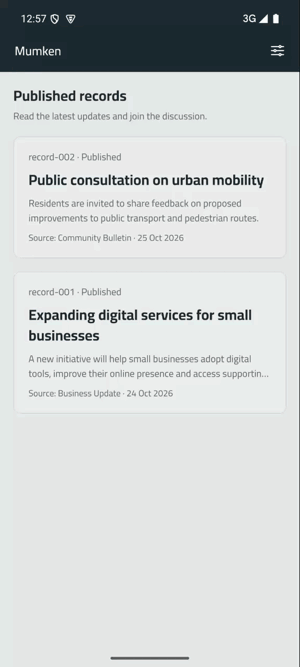](docs/videos/mobile-journey.mp4)

---

## Quick start

Requirements: **Node 20.19+** (22 recommended, see `.nvmrc`) and **npm 10+**. Mobile also needs Expo Go
58 on an iPhone, or an iOS Simulator (Xcode) / Android emulator.

```bash
npm install                 # one install for the whole workspace

# Web — http://localhost:3000 (redirects to /en or /ar from your browser language)
npm run dev:web

# Mobile — scan the QR code with the iPhone camera (Expo Go), or press i (iOS Simulator) / a (Android)
npm run dev:mobile
```

Production web build: `npm run build:web && npm run start:web`. Set `SITE_URL` to the public origin when
deploying, so canonical and `hreflang` links are absolute.

## Tests

```bash
npm test               # everything below except E2E: core + web + mobile unit/integration suites
npm run test:core      # Vitest: domain, data layer, i18n, contrast, composer state machine
npm run test:web       # Vitest + Testing Library + axe: the discussion journey on web
npm run test:mobile    # jest-expo + React Native Testing Library: the journey through the real navigator
npm run test:e2e       # Playwright (desktop + phone viewport): builds and starts the app, real browser + axe
npm run verify         # typecheck + lint + all unit/integration tests (what CI runs before E2E)
```

The first `test:e2e` run needs a Chromium build: `npx playwright install chromium` (run in `apps/web`).
Web screenshots can be regenerated with `npm run screenshots -w @commenting/web`.

## Performance

Lighthouse on the production build (record page): **94 / 100 / 100 / 100** on mobile (slow 4G, 4× CPU) and
**100 / 100 / 100 / 100** on desktop (Performance / Accessibility / Best practices / SEO). CLS is 0 on both.
First-load JavaScript is 219 KB gzipped, of which 47 KB is the app. Breakdown and the LCP trade-off:
[DECISIONS D11](docs/DECISIONS.md#d11--performance-and-scalability).

## Repository layout

```
packages/core/        @commenting/core: everything both apps share
  src/domain/         types, dataset schema, thread building, validation, language detection
  src/data/           repository interface + in-memory implementation, network simulator, drafts, storage
  src/i18n/           en/ar dictionaries, plural rules, date + relative-time formatting, locale negotiation
  src/theme/          design tokens (become CSS variables on web and StyleSheet values on mobile)
  src/react/          providers, TanStack Query hooks, useCommentComposer (the submission state machine)
  src/testing/        deterministic test services shared by all three test suites
apps/web/             Next.js 16 App Router (Cache Components), CSS Modules
apps/mobile/          Expo SDK 58, Expo Router native stack
docs/specs/           SDD: 01-requirements → 02-design → 03-tasks (with traceability matrix)
docs/                 DECISIONS.md, TESTING.md, COMPLIANCE.md, screenshots/, videos/
```

## Documentation

* [Requirements](docs/specs/01-requirements.md): IDs, acceptance criteria, **assumptions**
* [Design](docs/specs/02-design.md): architecture, data flow, state machine, RTL strategy, accessibility map
* [Tasks and traceability](docs/specs/03-tasks.md): every requirement mapped to its code and tests
* [Technical decisions, limitations and improvements](docs/DECISIONS.md)
* [Testing approach and results](docs/TESTING.md)
* [Brief compliance checklist](docs/COMPLIANCE.md): every line of the brief mapped to its implementation and proof
* [Screenshots](docs/screenshots/)

## Screenshots

| Web · desktop (EN) | Web · desktop (AR, RTL) |
| --- | --- |
| 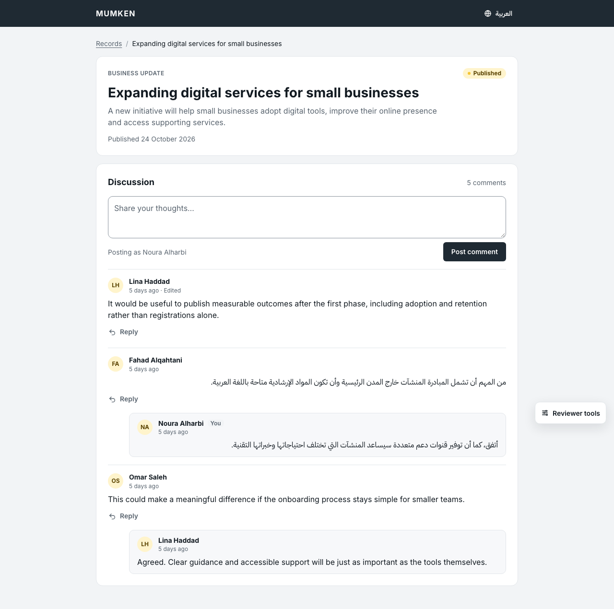 | 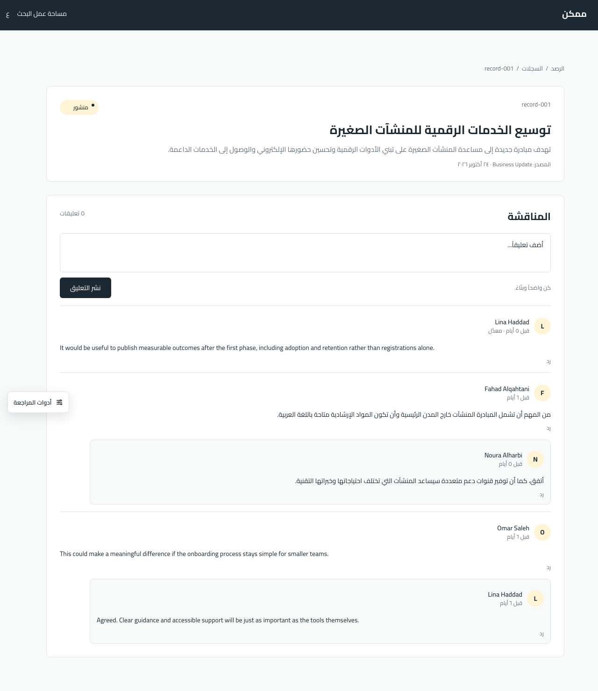 |

| Web · phone: failed post, text kept | Web · phone: reply | Web · phone (AR): empty |
| --- | --- | --- |
| 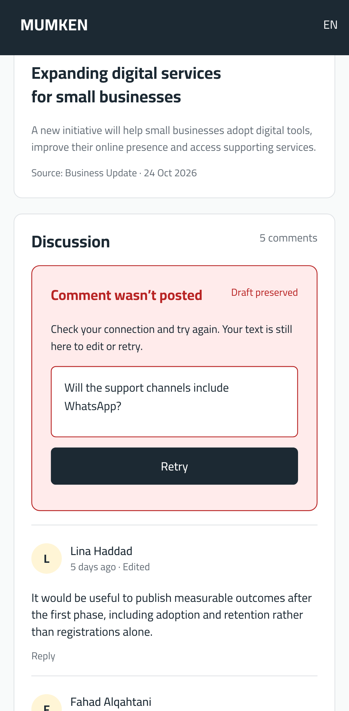 | 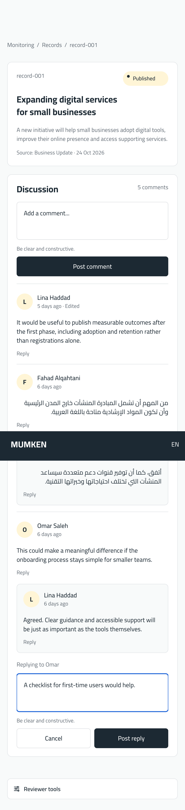 | 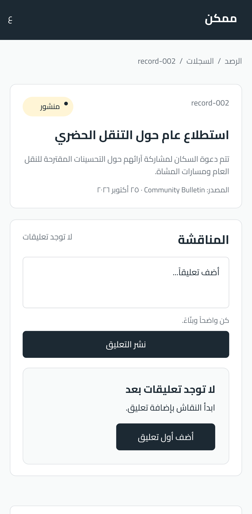 |

| Mobile: discussion | Mobile: reply | Mobile: failed post | Mobile (AR, RTL) | Mobile: empty |
| --- | --- | --- | --- | --- |
| 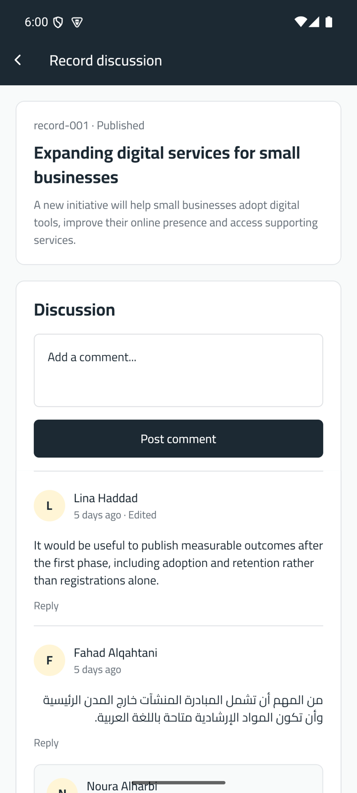 | 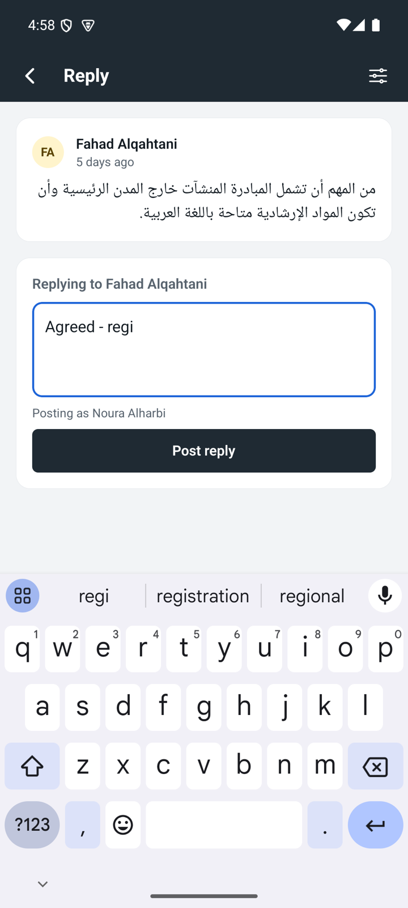 | 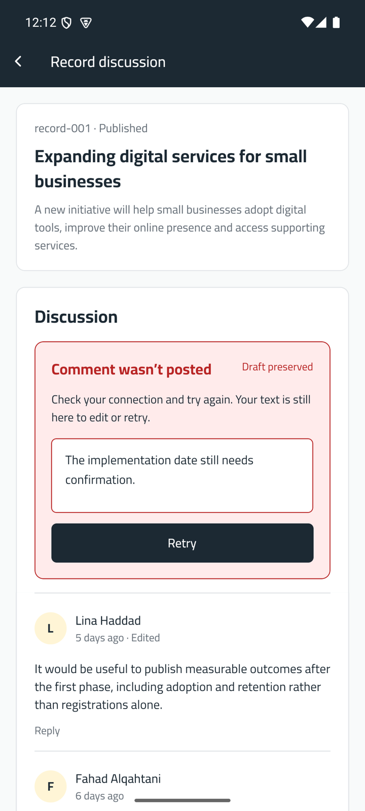 | 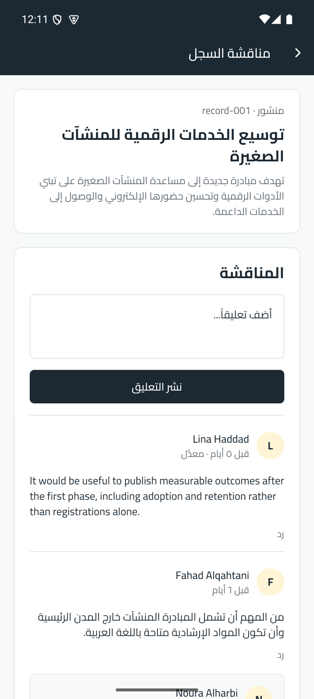 | 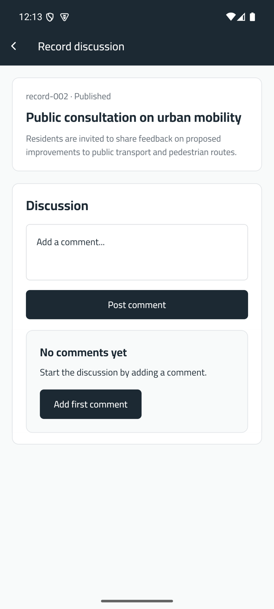 |

The mobile screenshots were captured in Expo Go on an Android emulator, because the development machine has no
Xcode (see [DECISIONS § Limitations](docs/DECISIONS.md#3-limitations-and-shortcuts)).
